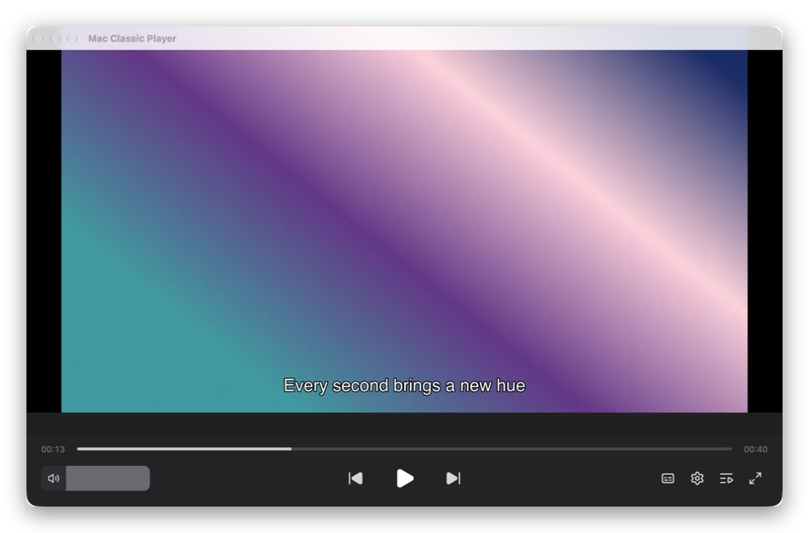
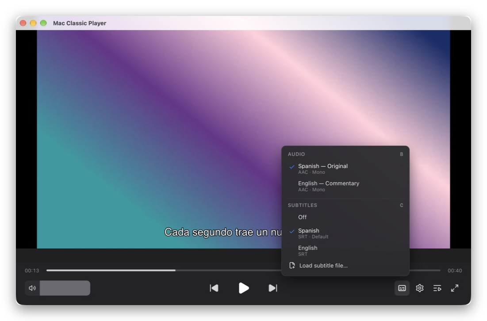
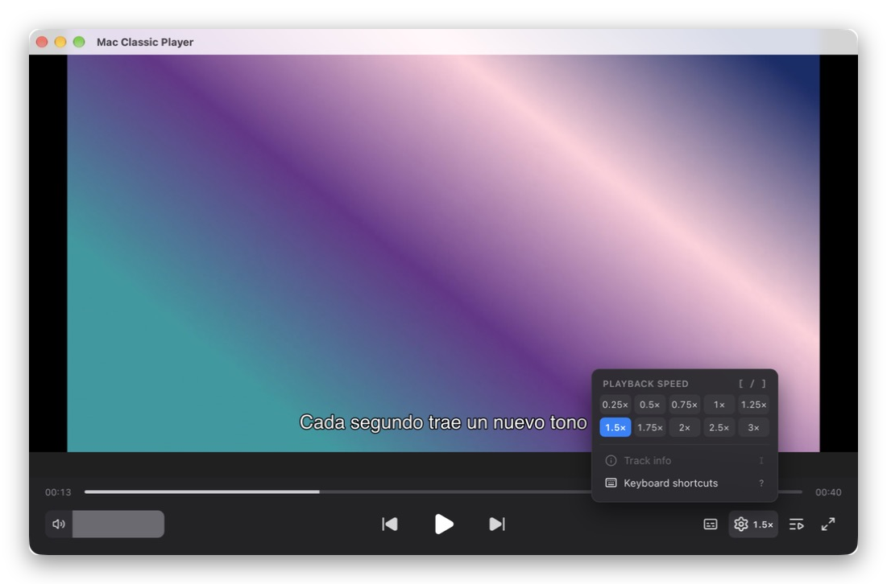
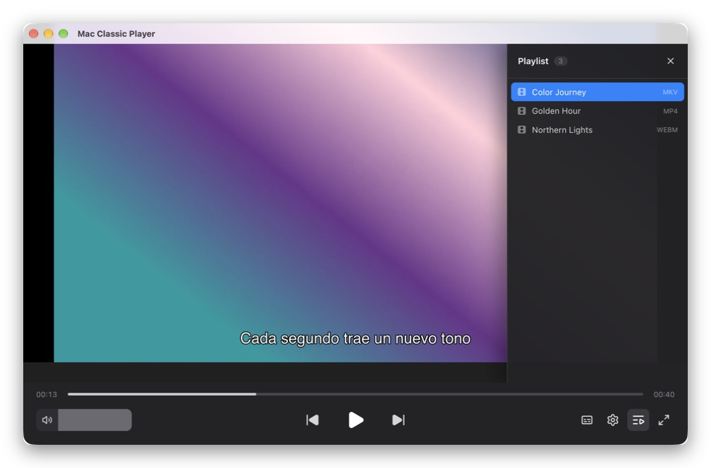
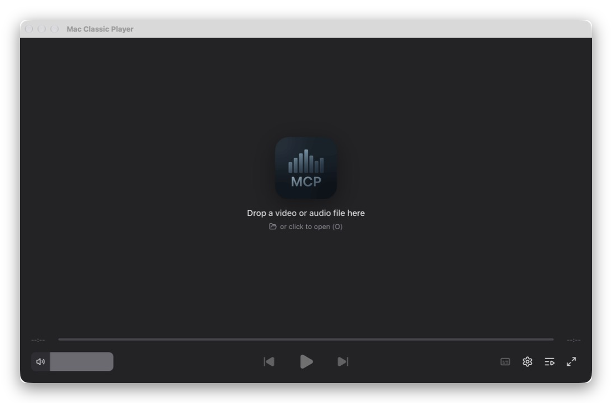

#  Mac Classic Player

Reproductor de video y audio para macOS con motor **mpv**: abre MKV y casi cualquier formato sin convertir, permite elegir la pista de audio y los subtítulos, y controlar la velocidad de reproducción. Interfaz oscura y minimalista, manejable por completo con el teclado.

<p align="center">
  
</p>

> Este proyecto es una versión modificada de [Mac Classic Player](https://github.com/piro0919/mac-classic-player), creado por [piro0919](https://github.com/piro0919) y publicado bajo licencia MIT.

---

## Novedades respecto al original

|                             | Original                              | Esta versión                                                                                  |
| --------------------------- | ------------------------------------- | --------------------------------------------------------------------------------------------- |
| Motor de reproducción       | `<video>` del navegador (WebKit)      | **mpv** (libmpv)                                                                              |
| Formatos                    | MP4, MOV, MP3, M4A, WAV               | MKV, WebM, AVI, TS, MPG, FLAC, Opus… y casi cualquier otro                                    |
| Pistas de audio             | Solo la predeterminada                | Elegir entre todas las del archivo                                                            |
| Subtítulos                  | No                                    | Internos (SRT, ASS con estilos, PGS de Blu-ray…) y externos (`.srt`, `.ass`, `.vtt`…)         |
| Velocidad                   | No                                    | De 0.25× a 3×, sin cambiar el tono de la voz                                                  |
| Interfaz                    | Barra de controles clásica            | Rediseño oscuro: barra de progreso amplia, controles centrados, lista de reproducción lateral |
| Actualizaciones automáticas | Desde los releases del autor original | Desactivadas                                                                                  |

## Capturas

<table>
  <tr>
    <td width="50%"><br /><sub><b>Audio y subtítulos:</b> todas las pistas del archivo, con idioma, formato y canales.</sub></td>
    <td width="50%"><br /><sub><b>Velocidad:</b> de 0.25× a 3×; se recuerda entre sesiones.</sub></td>
  </tr>
  <tr>
    <td width="50%"><br /><sub><b>Lista de reproducción:</b> abre varios archivos y salta entre ellos.</sub></td>
    <td width="50%"><br /><sub><b>Inicio:</b> arrastra archivos a la ventana o haz clic para abrirlos.</sub></td>
  </tr>
</table>

## Instalación

### Requisitos

- macOS 11 o posterior, en un Mac con Apple Silicon (M1 o posterior).
- [Homebrew](https://brew.sh) y **mpv**. La app usa mpv como motor de reproducción y no lo incluye:

  ```bash
  brew install mpv
  ```

### Pasos

1. Descarga el archivo `.dmg` de la última versión en la sección [**Releases**](../../releases/latest) de este repositorio.
2. Abre el DMG y arrastra **Mac Classic Player** a la carpeta **Aplicaciones**.
3. La primera vez que la abras, macOS dirá que no puede verificar al desarrollador, porque la app no está firmada con un certificado de Apple. Ve a **Configuración del Sistema → Privacidad y seguridad** y pulsa **Abrir de todos modos**.

Si la app muestra "The mpv playback engine is not installed", ejecuta `brew install mpv` y pulsa **Retry**.

## Uso

Abre archivos con **File → Open File…** (`⌘O`), haciendo clic en la ventana vacía, arrastrándolos a la ventana o con **Abrir con** desde el Finder. Si junto al video hay un subtítulo con el mismo nombre, se carga automáticamente. Por defecto se eligen el audio y los subtítulos en el idioma de tu Mac.

### Atajos de teclado

| Tecla     | Acción                                      |
| --------- | ------------------------------------------- |
| `Espacio` | Reproducir / pausar                         |
| `S`       | Detener                                     |
| `A` / `D` | Archivo anterior / siguiente                |
| `←` / `→` | Retroceder / avanzar 5 s                    |
| `↑` / `↓` | Subir / bajar volumen                       |
| `0` – `9` | Saltar al 0 %–90 % del archivo              |
| `[` / `]` | Más lento / más rápido                      |
| `R`       | Velocidad normal (1×)                       |
| `B`       | Siguiente pista de audio                    |
| `C`       | Siguiente subtítulo (incluye "desactivado") |
| `L`       | Mostrar / ocultar la lista de reproducción  |
| `M`       | Silenciar                                   |
| `F`       | Pantalla completa                           |
| `O`       | Abrir archivos                              |
| `I`       | Información de la pista (audio)             |
| `?`       | Mostrar los atajos                          |

## Desarrollo

### Requisitos

- [Node.js](https://nodejs.org) 24
- [Rust](https://www.rust-lang.org/tools/install) (estable):

  ```bash
  curl --proto '=https' --tlsv1.2 -sSf https://sh.rustup.rs | sh
  ```

- Herramientas de línea de comandos de Xcode: `xcode-select --install`
- mpv: `brew install mpv`

### Ejecutar en modo desarrollo

```bash
git clone https://github.com/Steve2412/mac-classic-player-strop.git
cd mac-classic-player-strop
npm install
npm run dev
```

La primera vez tarda varios minutos porque compila la parte en Rust. Después, los cambios en la interfaz (`renderer/`) se recargan al instante y los cambios en Rust (`src-tauri/`) recompilan y reinician la app.

### Comprobaciones

```bash
npm run lint          # ESLint
npm run type-check    # TypeScript
cargo test --manifest-path src-tauri/Cargo.toml   # Pruebas de Rust (incluye pruebas reales con mpv)
```

### Crear el DMG

```bash
APPLE_SIGNING_IDENTITY="-" npm run build
```

El instalador queda en `src-tauri/target/release/bundle/dmg/`. `APPLE_SIGNING_IDENTITY="-"` firma la app de forma local (ad-hoc). Sin esa firma, macOS diría que la app "está dañada" al descargarla.

### Publicar una versión

1. Sube la versión en `package.json`, `src-tauri/tauri.conf.json` y `src-tauri/Cargo.toml`.
2. Crea el DMG con el comando anterior.
3. `npm run release` crea el release en GitHub y sube el DMG (requiere la CLI `gh` con sesión iniciada).

### Cómo está hecho

- **Interfaz:** React 19 + TypeScript + Vite, en `renderer/`.
- **App nativa:** Tauri v2 (Rust), en `src-tauri/`.
- **Reproducción:** `src-tauri/src/mpv/` carga libmpv al arrancar y lo controla. `src-tauri/src/video_layer_macos.rs` dibuja el video con la API de render de mpv en una capa OpenGL situada debajo de la interfaz web, que es transparente en la zona del video.

Más detalles técnicos en [`CLAUDE.md`](./CLAUDE.md).

## Licencia

[MIT](./LICENSE). Basado en [Mac Classic Player](https://github.com/piro0919/mac-classic-player) © piro0919. mpv se distribuye por separado bajo su propia licencia (LGPL/GPL) y no se incluye en esta app.
